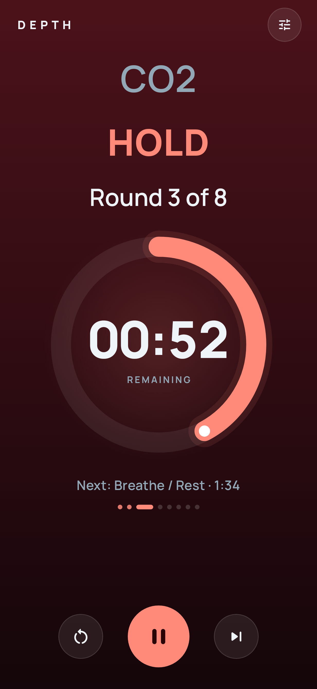
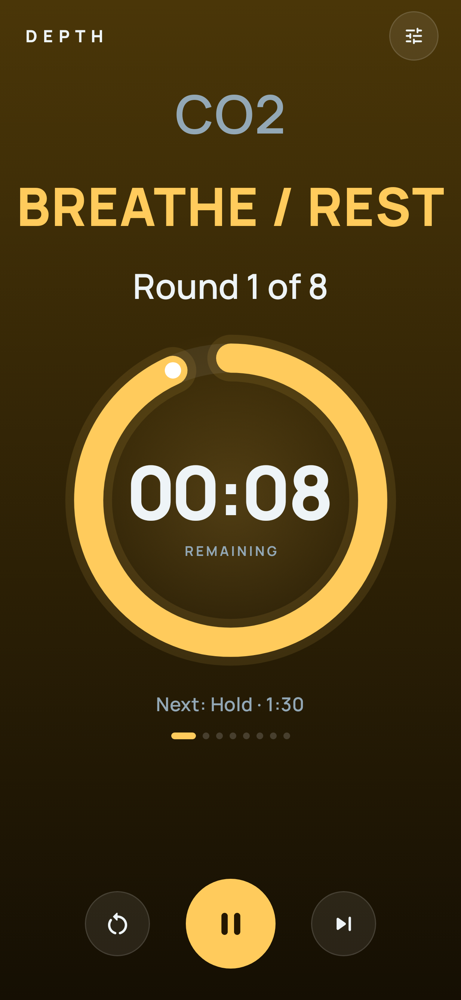
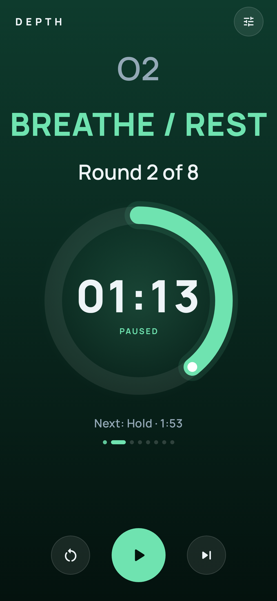
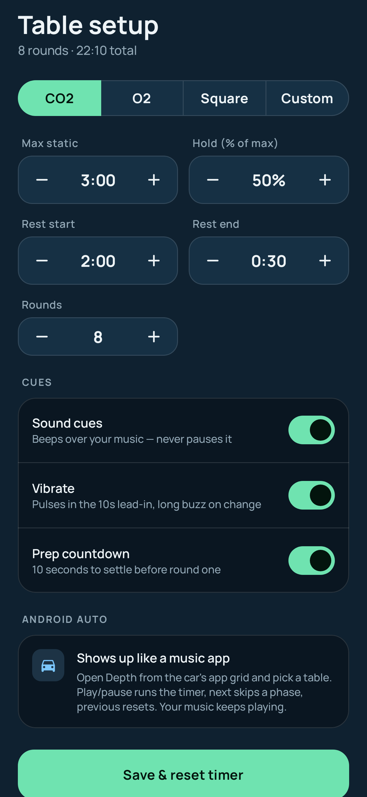
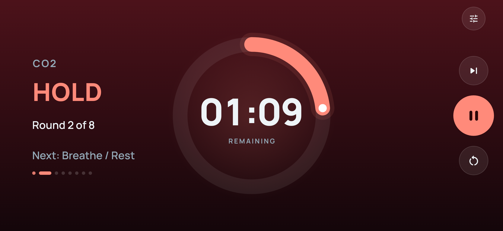
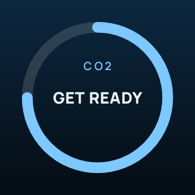
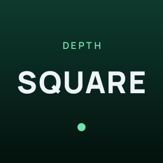

# Depth

A breath-hold trainer for freediving practice — CO2 tables, O2 tables, square breathing and
custom tables — on your phone and in **Android Auto**.

<p>
  
  
  
  
</p>


## Install

1. Download the latest `Depth-x.y.z.apk` from [Releases](../../releases) on your phone and open it
   (allow installs from your browser/files app when asked).
2. **If an older Depth build is installed, uninstall it first.** Releases are signed with a
   new key, so Android won't install them over the old Android Studio builds.
3. Open Depth once and allow notifications — that's what keeps the countdown running with
   the screen off and puts controls on your lock screen.

## Android Auto

Depth is a **media app** to Android Auto — the same kind of app as Navic or Tempus — so it
appears in the car's app grid next to your music apps.

- One-time: Android Auto → tap *Version* 10× → ⋮ → *Developer settings* → enable
  **Unknown sources** (required for any app not installed from the Play Store). If Depth
  isn't in the grid, check ⋮ → *Customize launcher*.
- Open Depth in the car and pick **CO2 Table, O2 Table, Square Breathing or Custom Table**.
  The now-playing screen shows:

  | Car screen | Shows |
  |---|---|
  | Title | Current phase and time left — `Hold · 1:25` |
  | Subtitle | `CO2 · Round 3 of 8`, or during the 10s lead-in `Breath hold in 7s · CO2` |
  | Progress bar | The current phase, start to finish |
  | Play / pause | Start or pause the timer |
  | Next | Skip to the next phase |
  | Previous | Reset the table |

      

- The phone and car always show the same timer — start on the phone, pause from the car.
- Depth never plays audio through Android Auto and never requests audio focus. Beeps play on
  the notification stream over whatever music is on.

### Why this works when the earlier builds didn't

The earlier builds used Android Auto's *template* app path (Car App Library, IoT category).
That path is gated much more tightly on phones, and the app never appeared in the launcher
no matter what was changed in the manifest. Media apps are discovered through a plain
`MediaBrowserService` + `<uses name="media"/>` — the path every sideloaded music player uses —
and the tests below reproduce that discovery check.

## Updating without Android Studio

- **Obtainium** (recommended): add `https://github.com/au12/Depth-Android` and your phone
  offers each new release as a one-tap update. The repo is private, so give Obtainium a
  GitHub token with read access to it.
- Or download the APK from Releases.

## Testing Android Auto

**Automated** — `./gradlew testDebugUnitTest` runs on any machine, no device needed:

- `AndroidAutoDiscoveryTest` — performs Android Auto's launcher discovery: queries for
  exported `MediaBrowserService`s, reads the `com.google.android.gms.car.application`
  metadata and checks it declares `media`; also fails on leftover Automotive OS or template
  declarations.
- `AndroidAutoSessionTest` — acts as the Android Auto host: gets the browse root (and
  confirms Depth refuses auto-resume on connect), lists the tables, sends play-from-browse,
  play, pause, next and previous, and checks the exact titles, subtitles, progress positions
  and lead-in announcements the car would display. Also fetches the artwork by URI.
- `ScreenshotTest` — renders the screens above into `docs/screenshots/`.
- CI also runs `scripts/verify-apk.sh` against the built APK.

**On a real Android Auto host, at your desk** — `scripts/dhu.sh` installs the APK on your
phone over USB and opens Google's Desktop Head Unit (the car-display emulator Google uses).
One-time phone setup: Android Auto → Developer settings → *Start head unit server*.

## Building

```sh
./gradlew assembleRelease          # app/build/outputs/apk/release/app-release.apk
```

Signing reads `keystore.properties` (git-ignored) or the `DEPTH_KEYSTORE_PATH`,
`DEPTH_KEYSTORE_PASSWORD`, `DEPTH_KEY_ALIAS`, `DEPTH_KEY_PASSWORD` environment variables;
without either it falls back to the debug key.

```properties
storeFile=../depth-signing/depth-release.jks
storePassword=…
keyAlias=depth
keyPassword=…
```

### Releases

Every push builds and tests. Tagging `vX.Y.Z` publishes a signed GitHub Release (versionCode
derived from the tag, so updates always install). One-time setup — add the signing key to
the repo's Actions secrets:

```sh
scripts/set-ci-secrets.sh path/to/depth-release.jks 'store-password'
git tag v0.2.0 && git push --tags
```

Keep `depth-release.jks` and its password somewhere safe. If it's lost, future builds can't
install as updates over existing ones.

## Project layout

```
engine/   BreathTimerEngine (shared timer, cues), TableBuilder (table math), SettingsStore
playback/ DepthMediaService (Android Auto + notification), NowPlaying (state → car text),
          Artwork + ArtworkProvider (car art tiles)
ui/       TrainerScreen, SettingsSheet, components, theme
```
